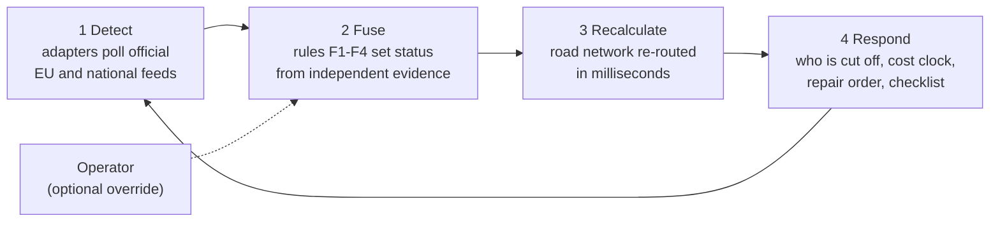

# Resilience Watch: what was built, how, and why

Status on 5 November 2026. Code: `resilience/` and GitHub `DimMiz1/resilience-watch` (latest commit e8152b8).
Mark anything you disagree with ❓ and I will change it.

---

## 1. Core idea

**When a road or bridge fails during a flood, authorities need to know who is cut off, what it costs, and what to do first. This should come within hours of the first official signal, not days.** Detection takes hours, because it depends on satellite passes and on agencies publishing their records. Recalculation takes milliseconds.

Hazard apps show *where the water is*. They do not show *what stops working*. We model the consequence: the **indirect cost of failing infrastructure**, meaning the lost access and lost time. Repair cost (direct cost) is out of scope.

The product is a loop that runs continuously and automatically:

The software has two views:

| View | When | Question it answers |
| --- | --- | --- |
| `/impact` (planning) | before a disaster | Which crossings would hurt most if lost, so they can be reinforced first? |
| `/operations` (incident) | during or after | Given what has failed now, who is affected, what is it costing, and what do we do? |

The primary audience is **authorities**: municipality, civil protection (ГДПБЗН), the road agency and ambulance dispatch (ЦСМП). The public map is the citizen channel, not the main pitch.

---

## 2. What was built, layer by layer

### 2.1 Road network (`build_network.py` → `data/burgas_south.json`)

**What it is.** A routable graph of the Burgas south coast (Sozopol, Primorsko, Tsarevo), built from OpenStreetMap through the Overpass API:

- 1,854 nodes, 2,219 road segments, 74 crossings, 35 settlements, 17 hospital records.

**How it is built:**
1. Download roads of class `unclassified` and above, plus places with population and `amenity=hospital`, for the bounding box 42.0–42.52 N, 27.35–28.0 E.
2. Convert each road segment to a travel time using a fixed speed per road class. Respect one-way streets.
3. Group bridge segments of the same road within 150 m into one **crossing**. A bridge in OSM is often split into several pieces.
4. Keep only the largest connected part of the network. Snap every settlement and hospital to the nearest road node in it.

**Why:**
- OSM is the only open, EU-wide, routable road dataset. Using it means the same command rebuilds the network for any EU region.
- Building it in advance means the app needs no internet map service during a crisis.
- The western edge was widened from 27.45 to 27.35 because Burgas was otherwise cut off from the rest of the network. The connecting road ran just outside the original box.

### 2.2 Impact engine (`network.py`)

**What it does.** For any set of closed crossings, it computes for every settlement:
- travel time to the nearest hospital and to the regional hospital (УМБАЛ Бургас), before and after the closure;
- whether the settlement is **cut off** (no road path at all);
- whether it **loses timely access** (more than 30 minutes to care after the closure);
- the new route (road numbers) and which hospital it now goes to.

**How.** Dijkstra shortest path from all hospitals at once, run once before and once after the closure. Each scenario takes about 3 ms, so the whole region can be recalculated on every click.

**Ranking (planning view).** Each of the 74 crossings is closed one at a time and ranked by:
1. population cut off;
2. then population losing timely access.

**Result.** The top crossing is the road 9901 bridge near Tsarevo. Closing it cuts off Ahtopol, Sinemorets, Varvara and Brodilovo, 2,415 people by OSM tags. The official CEMS activation EMSR693 for the 2023 flood states *"The main road Tsarevo - Sinemoretz is closed."* That is the same road, which is an independent sanity check.

### 2.3 Incident engine (`incidents.py`)

**Status of each crossing:**

| Status | Who can set it | Counted in impact? |
| --- | --- | --- |
| suspected | anyone, or the watcher automatically | no; an inspection is proposed |
| reported | anyone, such as a patrol or a citizen | shown separately as "if confirmed" |
| confirmed | operator only (when `OPERATOR_KEY` is set) | **yes** |
| reopened | operator only | incident closed; kept in the log |

**What it calculates from confirmed closures:**
- **Who is cut off and who loses timely access.** This comes from the impact engine.
- **Isolation person-hours: people cut off × hours cut off.** This is calculated step by step through the timeline, because closures happen at different times.
- **Cost clock: person-hours lost to detours.** The formula is *vehicles per day ÷ 24 × people per vehicle × detour hours × hours closed*. It is shown **only if the operator enters traffic figures**.
- **Projected total cost at the expected reopening time.**
- **Repair priority: which closed crossing, if reopened first, reconnects the most people.**
- **Response checklist (rule-based):**
  - critical: a settlement is cut off → arrange air or sea medical evacuation, inform the mayor, check vulnerable residents, consider a temporary medical post;
  - high: ambulance detour of 10 minutes or more → the new route and hospital; repair first; verify unconfirmed reports;
  - medium: keep the closed crossing signposted with police at the junctions; inspect flagged crossings, grouped by reason.

**Safety rules:**
- Event times must include a timezone, must not be in the future, and must be within 30 days.
- Only one open incident per crossing.
- Notes are limited to 200 characters.
- The operator key is compared in constant time.
- The store is written atomically under a lock.

### 2.4 Official-source watcher (`watcher.py`)

The watcher runs every 15 minutes inside the server. You can also start it with **"Check official sources now"**, at most once a minute.

Every source is an **adapter** that returns signals in one shared format: `id, source, kind, confidence, crossings, observed_at, ref, note`. Teammates can add adapters independently.

| Source | What it gives | Signal kind |
| --- | --- | --- |
| **Road agency, DATEX II** (АПИ national access point, `datasheet.api.bg`; public, no login, daily archive back to 2023) | Official records of closed roads (r01) and restricted roadways (r02), with coordinates | `closure` / `restriction` if the text names a hazard; otherwise `planned` (planned works) |
| **Flood extent** (Copernicus **GFM**, i.e. Sentinel-1, or a CEMS delineation, as GeoJSON) | Observed flooded area | `inundation` within 300 m of a crossing |
| **Copernicus EMS Rapid Mapping** | An open activation in Bulgaria whose area of interest contains a crossing | `aoi` |
| **GloFAS** (via the Open-Meteo flood API) | 10-day forecast above the cell's 5-year 99th percentile ("high") or record ("extreme") | `exposure` |
| **Meteoalarm** (EUMETNET / NIMH) | Live orange or red rain, flood, thunderstorm or coastal warning for Burgas (BG341), applied to the 5 highest-consequence crossings | `warning` |

**Fusion rule (automatic; operator can always override):**

| Rule | Evidence | Status |
| --- | --- | --- |
| F1 | An official closure record that names a hazard | **confirmed**, failure time = the record's start |
| F2 | Observed flood extent plus at least one independent source (another flood source, river forecast, or official restriction) | **confirmed** |
| F3 | Observed flood extent alone, or an official hazard-related restriction | **reported** |
| F4 | Area of interest, river forecast, weather warning or planned works | **suspected** |

Every incident stores its evidence (source, kind, confidence, time, link). The history marks each change as `automatic rule`, `operator` or `report`, so you can see why a bridge is in each state.

**Resilience behaviour:**
- Each source is checked independently. If one fails, the console marks it **outdated** and shows the time of its last good data. The other sources and manual reports keep working.
- A source that needs an account or URL not yet set shows **not configured**. This is not an error.
- Status never goes down automatically. A piece of evidence already used for a crossing is not reused, so an operator's reopening is not undone by the same record.
- GloFAS history thresholds are cached for 30 days, after the first live test hit the provider's rate limit (HTTP 429).

**Live test, 5 November:**
- All sources except GFM returned OK in 0.5 to 2.8 seconds. GFM needs an account.
- **The road-agency feed set the Izgrev bridge on II-99 to "reported".** The agency's record is active today: "restricted traffic at km 55+251 Tsarevo, narrowed arch bridge, introduced following the heavy rainfall and floods in Tsarevo municipality".
- A planned-works record (III-992 repair, partial closure) was correctly treated as context, not failure.

**What the 2023 record shows** (archive files of 4–20 September 2023, replayed through the same code):
- The national feed published the **Kiten bridge** damage on II-99 ("compromised bridge part following heavy rain and floods", over 12 t restricted) only on **15 September**, 10 days after the flood. It also published emergency works between Kondolovo and Gramatikovo on 18 September.
- The **Kiten bridge was outside the EMSR693 area of interest.** Copernicus EMS triage missed it, and the national record caught it.
- The closure of the **Tsarevo–Sinemorets road** named in EMSR693 **never appears** in the national feed.
- **Conclusion:** no single feed is timely and complete. This is why we fuse sources, and why a manual override stays.

### 2.5 Operations console (`/operations`)

The console is a phone-first web page. It has:
- headline figures, each tagged Observed or Modelled;
- an official-source health table;
- a map with crossings coloured by status (grey, amber, orange, red, green);
- a form: crossing, time, expected duration, optional vehicles per day and people per vehicle, note, operator key;
- the response checklist, which can be ticked off;
- repair priority, the cost clock, affected settlements and the incident log.

The page refreshes every 30 seconds, and the clocks update every minute.

**"Load replay: Tsarevo, 5 Sep 2023"** reconstructs the event, shifted to the present time:
- road 9901 is reported, then confirmed closed 6 hours ago, with an expected duration of 72 hours;
- the 13 other crossings inside the official EMSR693 area are flagged as suspected.

The replay uses a stored copy of that area, so it works offline.

### 2.6 Quality and delivery

- **Tests:** 107 Python tests and all JavaScript suites pass. The new code has 6 network tests, 6 incident tests, 6 watcher tests and server route tests.
- **Dependencies:** only the Python standard library on the server, and Leaflet in the browser.
- **Deployment:** Render, Frankfurt (EU), from the public GitHub repository. Deploys are manual.

---

## 3. Assumptions and why we chose them

Each assumption is labelled with how it appears in the app: **Observed** (from a source), **Modelled** (calculated by us) or **Assumed** (a parameter we chose).

### 3.1 Principles

| # | Assumption | Why | Risk |
| --- | --- | --- | --- |
| P1 | **Status is set automatically by fusing independent official evidence (F1–F4); no single satellite product can confirm a failure.** | In 2023 every single source failed on its own. The ERA5 rainfall was far too low, the radar on 8 September saw no water, EMSR693 was cancelled with no flood map, its area missed the Kiten bridge, and the national road feed was 10 days late and omitted road 9901. Agreement between sources is more reliable than any one of them. | F2 ("two sources agree → confirmed") is itself an assumption, and false confirmations remain possible. A manual override is kept, and every automatic status shows its evidence. |
| P2 | **Indirect cost first; no repair cost.** | This was the professor's focus: the cost of losing connections. Repair cost needs engineering data we do not have. | Judges may ask about repair cost; the answer is that it is out of scope. |
| P3 | **Person-hours are the headline; € is optional.** | Euro values depend on a value-of-time figure that is disputed. HEATCO is dated; the newer reference is the EU Handbook on the external costs of transport. Hours are understood without debate. | € can be added as a clearly labelled parameter. |
| P4 | **Never invent traffic or population.** | One fabricated number destroys credibility with authorities and judges. If traffic figures are missing, the app says what it needs instead of guessing. | Some fields are empty until an operator enters data. |
| P5 | **No single "resilience score".** | A composite score hides what drives it and cannot be checked. Separate, explainable figures can. | Less "headline-friendly". |
| P6 | **Pilot one region: Burgas south / Tsarevo.** | A real past event (2023), an official CEMS activation and local relevance. Depth over breadth. | Generalisation is a claim until a second region is built. |

### 3.2 Network model

| # | Assumption | Why | Risk |
| --- | --- | --- | --- |
| N1 | **Free-flow speeds by road class:** motorway 100, trunk 80, primary 70, secondary 60, tertiary 50, unclassified 40, links 30–50 km/h. | These are standard rural planning values. No congestion data is available for this region. | Times are optimistic. In a flood, roads are slower, so real detours are worse. |
| N2 | **Only roads of class `unclassified` and above are modelled.** | Tracks and residential streets add noise and false "escape routes" over dirt roads that are not usable in a flood. | A village reachable only by a track may appear cut off. This is stated in the app. |
| N3 | **Bridge segments of the same road within 150 m form one crossing.** | OSM splits single bridges into several pieces. | Two separate bridges closer than 150 m on the same road are merged. |
| N4 | **"Emergency care" = nearest OSM `amenity=hospital`.** | It is the only consistent open dataset. | Mixed quality: some records are polyclinics or "Бърза помощ" bases. The next step is ЦСМП ambulance bases and fire stations. |
| N5 | **30 minutes is the threshold for "timely access".** | It is a common emergency-access benchmark, and the parameter can be changed in the planning view. | Different services use different targets. |
| N6 | **Population from OSM `population` tags.** | Open and attached to the settlement node. | Uneven and possibly outdated. To be cross-checked with the NSI 2021 census or GHSL. |
| N7 | **Settlements snap to the nearest road node in the main network.** | It is needed for routing. | A village whose nearest node is across a river may be misrepresented. |
| N8 | **A closed crossing is fully closed.** | Floods usually close a bridge completely. Partial closures would need lane-level data. | Partial or weight-restricted closures are not modelled. |

### 3.3 Cost and time

| # | Assumption | Why | Risk |
| --- | --- | --- | --- |
| C1 | **All traffic over the crossing takes the detour**, at the detour time from the model. | This is simple and transparent, and the operator controls the traffic number. | Some trips are cancelled rather than diverted. |
| C2 | **Traffic spreads evenly over the day** (vehicles per day ÷ 24). | No hourly profile is available. | Daytime losses are underestimated and night-time losses overestimated. |
| C3 | **Cut-off settlements are counted as people × hours and as trips prevented, never as "infinite detour".** | A missing route has no finite detour time. Mixing the two would make the number meaningless. | Two separate figures to explain. |
| C4 | **The demo replay uses an expected closure of 72 hours.** | It is a plausible demo value, marked as an assumption. | Not the real 2023 duration, which is not yet verified. |

### 3.4 Official-source watcher

| # | Assumption | Why | Risk |
| --- | --- | --- | --- |
| W1 | **A CEMS area of interest (AOI) containing a crossing → suspected.** | It is the fastest official EU signal and is available before any flood map. | An AOI is a *requested mapping area*, not a flooded area, so the evidence is weak. In 2023 it missed the damaged Kiten bridge. |
| W2 | **GloFAS: forecast above the 5-year 99th percentile = "high".** | Official EFAS return periods need registration. A percentile threshold of the same cell's own history is honest and reproducible. | GloFAS cells are about 5 km and suited to larger rivers. Small torrents like Tsarevo's are poorly represented. |
| W3 | **Crossings are grouped into 0.1° cells (about 11 km) for GloFAS queries.** | This keeps the number of calls low (21 cells instead of 74 crossings) to stay within rate limits. | A bridge may be matched to a nearby river rather than its own. To be replaced by the OSM waterway each bridge crosses. |
| W4 | **Meteoalarm orange or red for Burgas flags the 5 highest-consequence crossings.** | Warnings are per province, not per bridge. The most useful action is to inspect the crossings whose loss hurts most. | It is a heuristic; the number 5 is a parameter. |
| W5 | **Check every 15 minutes.** | Warnings and CEMS update on the scale of hours. Fifteen minutes is real time for authorities while respecting the free APIs. | Not suited to second-by-second sensors. That would need a different source, such as water-level gauges. |
| W6 | **The replay plays recorded official data through the same adapters and fusion rule.** The data: the EMSR693 area, and the road-agency DATEX II files of 15 and 18 September 2023. The timeline is shifted so that it ends now. | The data is real and was recorded, not a hand-built scenario, and the demo works offline. | The 9901 closure and its 72-hour duration are entered as operator steps from the activation text. The duration is **assumed**. |
| F5 | **A road record matches a crossing within 400 m of one of the record's points, on the road the record names.** If no road is named, the limit is 150 m. | Record points are kilometre posts along the road, often kilometres apart. Joining them with straight lines matched bridges on other roads. | A record about a long section may name only its start and end points, so a crossing in the middle is missed. Linear referencing by kilometre is the fix. |
| F6 | **A road record counts as failure evidence only if its text names a hazard** (flood, rainfall, torrent, emergency, landslide, collapse, compromised). Otherwise it is planned works. | The "Closed Roads" category mostly contains planned repairs. One live record partially closes 7 km of a 21 km section. | Keyword matching on Bulgarian text can miss unusual wording. |
| F7 | **Flood extent within 300 m of a crossing counts as flooding at the crossing.** | GFM masks rivers as permanent water, so the flooded approach roads are the signal, not the span. | Steep terrain and dense areas reduce radar reliability, and small torrents may not show at all. |

### 3.5 Operation and hosting

| # | Assumption | Why | Risk |
| --- | --- | --- | --- |
| O1 | **Without `OPERATOR_KEY` the console runs in open demonstration mode.** | Judges and teammates can try it without credentials. | Must be set for any real use. |
| O2 | **The incident store is a JSON file.** | Zero dependencies and easy to inspect. | The Render free plan resets it on restart. Production would use a database. |
| O3 | **Hosting on Render, Frankfurt.** | The data stays in the EU, and the hosting is free and simple. | Cold starts and manual deploys. A local copy and a recorded video are the demo fallbacks. |
| O4 | **Response actions are fixed rules, not AI-generated.** | They are predictable and auditable, and they cannot hallucinate. Authorities need to know why an action is proposed. | Less flexible. The operator remains the decision-maker. |

---

## 4. What we deliberately do **not** claim

- We do not let a single satellite or forecast product confirm a failure. Confirmation needs an official closure record or two independent sources that agree.
- We do not claim "within seconds". Detection takes hours; recalculation takes milliseconds.
- We do not process Sentinel imagery directly. We use **Sentinel-derived products** (GFM, CEMS).
- We do not claim Galileo. Browser positioning is whatever the phone provides.
- We do not claim exact euro losses or repair costs.
- We call the 2023 replay **consistent with the official record**, not validation. The road-9901 failure duration is not in any record.

---

## 5. Unverified items (need checking)

| Item | Why it matters | How to check |
| --- | --- | --- |
| Which bridges actually failed in Sept 2023, and for how long | This is the validation of the model | **Partly answered:** the road-agency archive shows the Kiten bridge (II-99) restricted from 4 Sep to 6 Oct, and an arch bridge at km 55 in Tsarevo is still restricted today. Road 9901 and the durations still need checking with press reports and the Tsarevo municipality. |
| The roughly 300 mm local rainfall figure | Supports the argument that satellites missed the event | NIMH station data |
| ~~Whether АПИ publishes a road-closure feed~~ | | **Answered:** yes. It is public DATEX II at `datasheet.api.bg`, with a daily archive, and it is now wired in. |
| GFM API access and quotas | Needed for the flood-extent adapter | Register at the GFM portal (free account). Check whether the archive has Tsarevo for September 2023. |
| Whether the GFM / CEMS archive has a road-network flood elsewhere in the EU | Needed to show F2 on real data | Search the GFM archive |
| Population figures | The headline number | NSI 2021 census |
| Hackathon rules on work done before the event, and the venue | A prototype built in advance might be penalised | CASSINI registration page |
| "flexapi for building" | This is the professor's idea | Ask the professor |

---

## 6. Next steps (proposed order)

1. Register for GFM; set `FLOOD_EXTENT_URL` (or write the authenticated GFM client); record one real event with flood polygons over roads for replay of rule F2.
2. Population cross-check with NSI 2021 or GHSL (GFM also provides a GHSL affected-population layer).
3. Confirm 2023 durations (press, municipality) and replace the assumed 72 h.
4. Replace hospitals with ЦСМП ambulance bases and fire stations.
5. Match each bridge to its own OSM waterway; linear referencing of road records by km.
6. Pitch script, five minutes, authority-first. Feature freeze about five days before the event.
